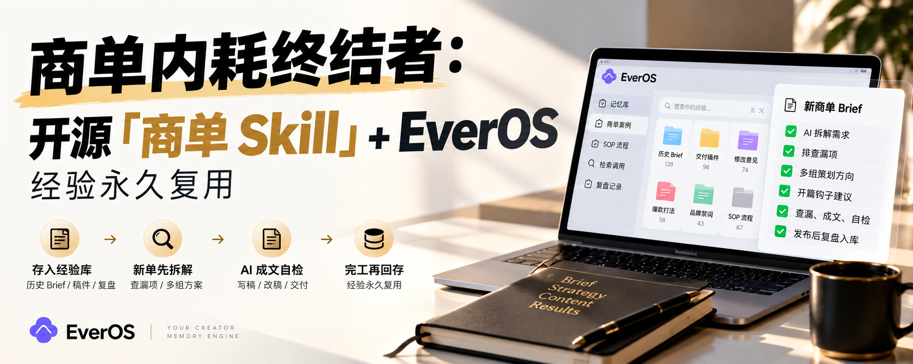

# 商单 Skill · shangdan-post-skill



> 给内容创作者的**商单写作前置功能**：开写之前，先让 AI 把你过往每一单的经验调出来——
> 拆 Brief、给方向、出钩子、查漏项；写完自检，发布后复盘归档。下一单，不再从零起步。

接商单的博主最累的从来不是写帖子，是每一单都要从零起步：
反复重读 Brief、逐条核对要求、拼命回忆上次的打法与驳回原因；
选题角度、策划方向临场硬想，没方向、没参照；
创意枯竭、脑子空空，却又盼着这条能吸引人、能出圈——越想爆，越卡壳。

**这个 Skill，就是来包揽这些重复劳动的。**

## 它怎么工作：前置三步

| 步 | 做什么 |
|---|---|
| ① 存入经验库 | 过往 Brief、交付稿件、解析清单、踩坑与改稿复盘全部入库，转为可检索记忆 |
| ② 自动沉淀 SOP | 每单归档成独立案例，反复出现的规则自动提炼成可复用的 SOP / Skill |
| ③ 新单先拆再动笔 | 新 Brief 先排查漏项、给出多组策划方向 + 开篇钩子由你敲定，再成文、自检、发布、复盘回存 |

方法论一句话：**记录 → 提炼 → 新单先检索 → 完工再回存。**

## 记忆存储，完全由你做主（二选一）

- ✅ **本地存储**：只生成 Markdown 文件，所有经验只留在自己电脑里，不外流（见 `memory_local/`，零依赖起步推荐）；
- ✅ **云端存储**：接入 [EverOS](https://everos.evermind.ai) 这类记忆工具，经验自动沉淀、随时一键检索调用，自托管与云端同一套 API（见 `docs/everos-integration.md`）。

Skill 本体只依赖 4 个记忆操作（search / add / correct / delete），换后端不用改流程。对比见 `docs/memory-backends.md`。

## 强钩子是内置标准，不是玄学

- 前两句必须点名人群、说清价值、留悬念；共鸣优先（真实痛点，不贩卖焦虑）；
- **禁用“翻车 / 整单白做”式灾难化夸大**——创作者的真痛点是重复与枯竭，钩子规范与公式见 `docs/pain-points-and-hooks.md`；
- 内容五问（钩子 / 受众 / 价值 / 意外点 / 带走什么）缺一不开写。

## 爆款方法论：三条道 · 三条术

单条爆款有运气成分，**能持续做出爆款才是真正的实力**。本 Skill 内置了这套方法论（框架来源：推特 @wquguru 分享的爆款经验，由维护者整理蒸馏，详见 `docs/viral-playbook.md`）：

- **三条道（慢变量）**：找准账号定位（垂直清晰才会被持续推荐）、跟踪热点借势（时机比努力更贵）、持续稳定输出（围绕近两天已验证的点深挖）；
- **三条术（快变量）**：带参链接放评论区（正文放链接易限流）、优化第一句话（前 3 秒决定停留）、发布后 30 分钟内自 quote（同话题、不同角度、高质量、不带广告）。

方法论提概率、不保结果；红线（Brief 合同、禁用夸大、不编造）永远优先于技巧。

## 谈判关：接单前，先把条件谈清

本 Skill 原本从“已有 Brief”开始；谈判关补上 Brief 之前的那一步，重点是**小红书商单的前期谈判技巧**（详见 `docs/negotiation-playbook.md`，框架源自 @JessiCao_JC 的分享）：

- 先问清再报价：拍什么、给谁用、改几次、钱怎么到账；信息不齐不报价；
- 合作资料一页纸：定位、近期表现、三篇代表作、可交付内容、合作条件；
- 角色三分问：代表哪个品牌、谁确认终审、谁下单签约付款；
- “水上水下”先问定义；返点与到账按链条逐项算，不只看订单金额；
- 报价写法是基础价 + 另议项：修改轮次、投流、二改、排竞分开谈；
- 红灯先停：无基础费的效果付费、“小改”变重拍、素材范围含糊、先交认证费。

谈判结果直接填进 Brief 拆解表的谈判前置项；没谈清的进待确认问题，不猜、不开写。

## 快速开始

```bash
git clone <this-repo> && cd shangdan-post-skill
# 1) 把 SKILL.md（连同 templates/、docs/）装进你的 Agent 的 skills 目录，
#    或在对话开头让它先读 SKILL.md
# 2) 本地记忆模式：填创作者档案
cp memory_local/profile.example.md memory_local/profile.md
# 3) 新建一单（可选脚手架）
python3 scripts/new_campaign.py my-first-deal --brand 示例品牌
```

然后对助理说：「我接了个新商单，Brief 在 xxx.pdf，用商单 Skill 走。」
完整版见 `docs/quickstart.md`。

## 目录

```
SKILL.md                    # Skill 本体（Agent 读这个）
docs/
  quickstart.md             # 5 分钟上手
  workflow.md               # 前置流水线详解
  pain-points-and-hooks.md  # 创作者痛点全图 + 强钩子手册（公式/禁用项/示例）
  viral-playbook.md         # 爆款方法论：三条道 · 三条术（定位/热点/深挖 + 链接/首句/自 quote）
  negotiation-playbook.md   # 小红书商单前期谈判技巧（报价/返点/水上水下/六步流程/红灯清单）
  memory-backends.md        # 存储二选一与后端对比
  everos-integration.md     # EverOS 云端/自托管接入
templates/
  brief_intake.md           # Brief 拆解表（基础条款 9 项）
  five_questions.md         # 内容五问表
  outline.md                # 大纲模板
  prepublish_checklist.md   # 发布前自检
  case_retro.md             # 复盘归档（含改稿经验）
memory_local/               # 本地 Markdown 记忆层
examples/
  example_fictional.md      # 虚构品牌完整走查
scripts/
  new_campaign.py           # 建单脚手架
```

## 设计原则
- **前置优先**：经验在动笔前起作用，不做事后诸葛。
- **红线 > 内容**：合规与钩子冲突时，红线赢。
- **不编造**：没实跑的演示留占位，数据注明来源与核对日期。
- **人终审**：AI 负责记与查，内容调整与发布永远由创作者终审。
- **隐私本地化**：报价、结算、联系人永不入帖、不入截图、不入示例。

## 致谢
感谢推特大佬 **@wquguru** 分享的爆款技巧：本仓库“爆款方法论：三条道 · 三条术”的框架（定位、热点、持续输出；链接放评论区、首句前 3 秒、30 分钟自 quote）源自他的经验分享，由维护者整理蒸馏并接入 Skill 流水线，详见 `docs/viral-playbook.md`。

感谢 **@JessiCao_JC** 分享的小红书商单谈判技巧：本仓库“小红书商单前期谈判技巧”（先问清再报价、合作资料一页纸、角色三分问、“水上水下”先问定义、返点与到账链条、报价写法、六步流程、红灯清单）的框架源自她的文章《小红书接广到底怎么运转？粉丝门槛、报价、返点和“水上水下”，一次讲清楚》，由维护者整理蒸馏并接入 Skill 谈判关，详见 `docs/negotiation-playbook.md`。

## License
MIT © modengsir，见 `LICENSE`。
